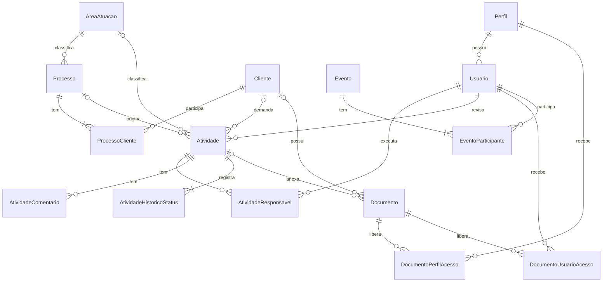
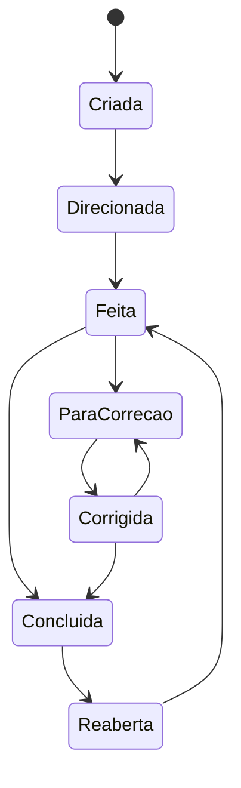

# Sistema de Controle de Atividades Jurídicas — Modelagem de Domínio

Data: 2026-10-06
Estado: aguardando revisão

## 1. Objetivo

Entregar a um escritório de advocacia uma ferramenta para criar, direcionar, executar, revisar e acompanhar atividades jurídicas, com cadastro de clientes, processos, documentos e agenda, e trilha de auditoria completa.

Esta spec define o modelo de domínio e as decisões de arquitetura. Ela não contém código. O uso de IA para produtividade é um objetivo posterior e não faz parte deste documento.

### Critérios de sucesso

- A Diretoria consegue criar uma atividade, direcioná-la a um ou mais responsáveis, revisá-la e concluí-la, com todo o percurso registrado.
- Um usuário de Produção enxerga apenas as atividades em que é responsável e apenas o seu próprio direcionamento.
- Contratos de Honorários nunca ficam acessíveis a usuários de Produção.
- Toda alteração e toda consulta feita no sistema pode ser rastreada pela Diretoria.

## 2. Decisões de arquitetura

| Tema | Decisão |
|---|---|
| Estilo | Monolito, DDD em camadas, escritório único (sem multi-tenant) |
| Plataforma | .NET 10, Blazor com renderização Interactive Server |
| Persistência | EF Core + PostgreSQL |
| Solução | Quatro projetos: `Domain`, `Application`, `Infrastructure`, `Web` |
| Chamada UI → aplicação | As páginas Blazor chamam os casos de uso diretamente; não há API HTTP intermediária |

### Dependências entre projetos

- `Domain`: nenhuma dependência de pacote ou projeto. Agregados, entidades, value objects, enums, exceções de domínio.
- `Application`: depende de `Domain`. Casos de uso (uma pasta por caso), interfaces de repositório e de serviços externos, autorização, `Resultado`.
- `Infrastructure`: depende de `Application` e `Domain`. `DbContext`, configurações de mapeamento (uma classe por entidade), repositórios, unidade de trabalho, armazenamento de arquivos, interceptor de auditoria, migrations.
- `Web`: depende das três. Componentes e páginas Blazor, autenticação, composição de dependências.

Dentro de cada camada há uma pasta por contexto.

### Referência

O repositório `C:\GitHub\NossoCT` serve de referência em duas partes distintas:

- `Administrativo` (Blazor Interactive Server, Domain/Application/Infrastructure/Web): referência de estrutura, entidades ricas, value objects, repositórios, unidade de trabalho e mapeamento por classe de configuração.
- `Comuns` + `NossoCTProject` (ASP.NET MVC, não Blazor): referência conceitual para perfis, desenho da auditoria (interceptor + contexto do ator + tabela com diferenças em JSON) e abstração de armazenamento de arquivos.

Não são copiados: multi-tenant por banco, mensageria, microserviços, controller CRUD genérico com bind de entidade, catálogo de permissões granulares, permissões em claims de cookie, arquivos binários dentro do banco.

## 3. Contextos

| Contexto | Agregados | Depende de |
|---|---|---|
| Identidade | `Usuario`, `Perfil` | — |
| Cadastros | `Cliente`, `Processo`, `AreaAtuacao` | Identidade |
| Documentos | `Documento` | Identidade |
| Atividades | `Atividade` | Identidade, Cadastros, Documentos |
| Agenda | `Evento` | Identidade, Cadastros, Atividades |
| Auditoria | `RegistroAuditoria`, `RegistroAcesso` | Identidade |

Agregados de contextos diferentes se referenciam apenas por Id.

## 4. Regras comuns a todas as entidades

- `Id`: Guid versão 7.
- Carimbos: `CriadoEm`, `CriadoPor`, `AtualizadoEm`, `AtualizadoPor`.
- Exclusão sempre lógica: `ExcluidoEm`, `ExcluidoPor`, com filtro global nas consultas. Nenhum registro de negócio é removido fisicamente.
- Datas e horas gravadas em UTC e exibidas no fuso do escritório, definido em configuração.
- As tabelas de auditoria (seção 10) são exceção: não têm carimbos de atualização nem exclusão lógica.

## 5. Identidade

### Perfil

| Campo | Regra |
|---|---|
| `Nome` | Obrigatório, único |
| `Tipo` | Enum `TipoPerfil`: `Diretoria` ou `Producao` |
| `Ativo` | Perfil inativo não pode ser atribuído a usuário |

Semeado com dois perfis: "Diretor" (`Diretoria`) e "Produção" (`Producao`). Perfis criados depois escolhem um dos dois tipos. As regras de negócio consultam o `Tipo`; a lista de acesso de documentos usa o `PerfilId`.

### Usuario

| Campo | Regra |
|---|---|
| `Nome` | Obrigatório |
| `Email` | Obrigatório, único; é o login |
| `SenhaHash` | PBKDF2; nunca exposto nem auditado |
| `PerfilId` | Obrigatório; exatamente um perfil por usuário |
| `NumeroOab` | Opcional |
| `Ativo` | Ver regras abaixo |
| `UltimoAcessoEm` | Atualizado no login |

Regras:

- Usuário inativo não faz login e não pode ser incluído como responsável, revisor ou participante. Continua visível no histórico.
- O sistema sempre mantém ao menos um usuário ativo com perfil de tipo `Diretoria`. Inativar, excluir ou trocar o perfil do último é recusado.
- Não há cadastro público. Somente a Diretoria cria, edita, inativa usuários e troca perfis.

### Autenticação e autorização

- Autenticação por cookie.
- Toda página exige usuário autenticado por padrão; o acesso anônimo é exceção declarada (tela de login).
- A autorização tem duas fontes:
  1. o `Tipo` do perfil do usuário;
  2. a relação do usuário com o recurso (é responsável da atividade, está na lista de acesso do documento, participa do evento).
- As regras são verificadas nos casos de uso da `Application`. A interface apenas oculta o que o usuário não pode fazer.
- O perfil e o estado ativo do usuário são lidos do banco a cada operação, não de dados guardados no cookie, para que uma mudança de perfil ou inativação valha imediatamente.

### Matriz de acesso

| Recurso | Diretoria | Produção |
|---|---|---|
| Usuários, perfis, áreas de atuação | Tudo | Sem acesso |
| Clientes e processos | Tudo | Somente leitura |
| Documentos Gerais | Tudo | Leitura conforme lista de acesso |
| Contratos de Honorários | Tudo | Sem acesso |
| Atividades | Tudo | Somente as em que é responsável |
| Agenda | Todos os eventos | Eventos em que participa; cria os seus |
| Auditoria | Consulta | Sem acesso |

## 6. Cadastros

### AreaAtuacao

`Nome` (obrigatório, único) e `Ativo`. Representa o ramo do direito (Trabalhista, Cível, Tributário etc.). Área inativa não pode ser usada em registros novos.

### Cliente

Classe abstrata com duas derivadas, persistidas em uma tabela com discriminador.

| Classe | Campos |
|---|---|
| `Cliente` (base) | `Email`, `Telefone`, `Endereco` (value object), `Observacoes`, `Ativo` |
| `ClientePessoaFisica` | `NomeCompleto` (obrigatório), `Cpf` (value object, obrigatório, único), `Rg`, `DataNascimento` |
| `ClientePessoaJuridica` | `RazaoSocial` (obrigatório), `NomeFantasia`, `Cnpj` (value object, obrigatório, único), `NomeResponsavel`, `InscricaoEstadual`, `InscricaoMunicipal` |

- `Cpf` e `Cnpj` validam dígitos verificadores.
- O tipo do cliente (PF ou PJ) não muda depois de criado.
- As áreas "Documentos Gerais" e "Contratos de Honorários" do cliente são consultas ao contexto Documentos filtradas por cliente e categoria; não são coleções do agregado `Cliente`.

### Processo

| Campo | Regra |
|---|---|
| `NumeroCnj` | Value object; opcional; único quando informado |
| `Titulo` | Obrigatório |
| `AreaAtuacaoId` | Obrigatório |
| `Status` | Enum: `Ativo`, `Suspenso`, `Arquivado`, `Encerrado` |
| `Orgao`, `Comarca`, `ParteContraria` | Opcionais |
| `DataDistribuicao`, `ValorCausa`, `Observacoes` | Opcionais |

`ProcessoCliente` (dentro do agregado): `ClienteId` e `Polo` (enum `Ativo`, `Passivo`, `Terceiro`).

Regras:

- Um processo tem ao menos um cliente; um cliente não se repete no mesmo processo.
- Não é possível remover do processo um cliente que tenha atividade vinculada a esse processo.
- Alterar a área do processo altera a área de todas as atividades vinculadas a ele.

## 7. Documentos

### Documento

| Campo | Regra |
|---|---|
| `Nome` | Obrigatório; padrão é o nome do arquivo enviado; editável |
| `NomeArquivoOriginal`, `TipoConteudo`, `TamanhoBytes` | Preenchidos no envio; imutáveis |
| `HashSha256` | Calculado no envio; imutável |
| `ChaveArmazenamento` | Localização do arquivo no armazenamento; imutável |
| `Categoria` | Enum: `DocumentoGeral`, `ContratoHonorarios`, `DocumentoAtividade`; imutável |
| `ClienteId` | Obrigatório em `DocumentoGeral` e `ContratoHonorarios` |
| `AtividadeId` | Obrigatório em `DocumentoAtividade` |

Tabelas auxiliares, dentro do agregado:

- `DocumentoPerfilAcesso`: `DocumentoId`, `PerfilId`.
- `DocumentoUsuarioAcesso`: `DocumentoId`, `UsuarioId`.

### Armazenamento

O arquivo fica fora do banco de dados, atrás de uma interface de armazenamento definida na `Application`. A primeira implementação grava em disco; a troca por armazenamento de objetos não altera o domínio. O banco guarda somente metadados e hash.

Não há versionamento. Substituir um documento é enviar um novo e excluir logicamente o anterior.

### Regra de acesso

Uma única função de domínio decide se um usuário pode acessar um documento:

1. Usuário com perfil de tipo `Diretoria` acessa sempre.
2. Caso contrário, acessa se o seu `PerfilId` constar em `DocumentoPerfilAcesso` ou se ele constar em `DocumentoUsuarioAcesso`.

Listagens exibem apenas documentos que o usuário pode acessar.

### Comportamento por categoria

| Categoria | Lista de acesso inicial | Restrição | Quem envia e gerencia |
|---|---|---|---|
| `DocumentoGeral` | Todos os perfis ativos | Nenhuma | Diretoria |
| `ContratoHonorarios` | Vazia | O domínio recusa incluir perfil de tipo `Producao` ou usuário de perfil `Producao`, sem exceção | Diretoria |
| `DocumentoAtividade` | Usuários responsáveis da atividade | Nenhuma | Responsáveis da atividade enviam; Diretoria gerencia |

- Um perfil criado depois é incluído automaticamente na lista de acesso de todos os Documentos Gerais existentes.
- Um usuário incluído como responsável de uma atividade recebe acesso aos documentos já anexados a ela. Removê-lo da atividade retira esse acesso.
- As regras de `DocumentoAtividade` são uma definição inicial; o detalhamento dessa área será objeto de especificação própria.

## 8. Atividades

### Atividade (raiz do agregado)

| Campo | Regra |
|---|---|
| `Titulo` | Obrigatório |
| `Descricao` | Obrigatório |
| `DataEntrega` | Obrigatória a partir do status `Direcionada` |
| `Status` | Enum `StatusAtividade` (ver fluxo) |
| `ConcluidaEm` | Preenchido ao entrar em `Concluida`; limpo ao reabrir |
| `ClienteId` | Opcional |
| `ProcessoId` | Opcional |
| `AreaAtuacaoId` | Com processo: igual à do processo, não editável. Sem processo: opcional, informada |
| `TipoAutor` | Enum: `Usuario` ou `Sistema` |
| `AutorId` | Usuário de Diretoria quando `TipoAutor = Usuario`; nulo quando `Sistema` |
| `RevisorId` | Usuário de Diretoria; obrigatório a partir de `Direcionada` |

Regras de vínculo:

- Com processo, o cliente é obrigatório e deve ser um dos clientes do processo.
- Atividade avulsa é a que não tem cliente nem processo.
- Uma atividade pode ter cliente sem processo.

### Entidades internas

| Entidade | Campos | Regra |
|---|---|---|
| `AtividadeResponsavel` | `UsuarioId`, `Direcionamento`, `ConcluidoEm` | Um usuário não se repete na mesma atividade. `ConcluidoEm` nulo significa parte pendente |
| `AtividadeComentario` | `Texto`, `UsuarioId`, `DataHora` | Imutável depois de criado |
| `AtividadeHistoricoStatus` | `StatusAnterior`, `StatusNovo`, `UsuarioId`, `DataHora`, `Motivo` | Somente inserção. `UsuarioId` nulo indica transição feita pelo sistema |

### Fluxo de status

| De | Para | Gatilho | Quem |
|---|---|---|---|
| — | `Criada` | Criação sem responsável | Diretoria ou sistema |
| `Criada` | `Direcionada` | Definição de ao menos um responsável, do revisor e da data de entrega | Diretoria |
| `Direcionada` | `Feita` | Último responsável conclui sua parte | Automático |
| `Feita`, `Corrigida` | `Concluida` | Aprovação | Revisor |
| `Feita`, `Corrigida` | `ParaCorrecao` | Devolução com motivo e responsáveis selecionados | Revisor |
| `ParaCorrecao` | `Corrigida` | Último responsável selecionado conclui novamente | Automático |
| `Concluida` | `Reaberta` | Reabertura com motivo e responsáveis selecionados | Diretoria |
| `Reaberta` | `Feita` | Último responsável selecionado conclui | Automático |

Regras do fluxo:

- Qualquer transição fora da tabela é recusada pelo domínio.
- Toda transição insere uma linha em `AtividadeHistoricoStatus`. Criar a atividade já com responsáveis insere duas: `Criada` e `Direcionada`.
- Na devolução e na reabertura o motivo é obrigatório e é gravado no histórico. A seleção de responsáveis vem com todos marcados por padrão e exige ao menos um; os selecionados têm `ConcluidoEm` limpo, os demais permanecem concluídos.
- Um responsável só conclui sua parte nos status `Direcionada`, `ParaCorrecao` e `Reaberta`, e só se a parte estiver pendente.
- "Atrasada" não é status. É uma condição calculada: `DataEntrega` anterior à data atual e status diferente de `Concluida`.
- Não existe status de cancelamento. Atividade criada por engano é excluída logicamente pela Diretoria.

### Regra do revisor

- Quando há exatamente um responsável com perfil de tipo `Diretoria`, `RevisorId` é esse usuário e o domínio recusa alterá-lo.
- Quando não há nenhum, ou há dois ou mais, a Diretoria escolhe o revisor entre os usuários ativos de tipo `Diretoria`.
- A regra é reavaliada a cada inclusão ou remoção de responsável. Se a reavaliação liberar a escolha, o revisor atual é mantido até que a Diretoria o altere.
- Quando o revisor é o único responsável da atividade, concluir a parte leva a atividade diretamente a `Concluida`. O histórico registra as duas transições (`Feita` e `Concluida`).

### Permissões

| Ação | Quem |
|---|---|
| Criar, editar, excluir | Diretoria |
| Incluir e remover responsáveis, editar direcionamentos, trocar revisor | Diretoria, nos status `Criada`, `Direcionada`, `ParaCorrecao` e `Reaberta` |
| Aprovar e devolver | O revisor da atividade |
| Reabrir | Diretoria |
| Concluir a própria parte | O responsável |
| Comentar | Diretoria e responsáveis |
| Ver a atividade | Diretoria e responsáveis |
| Ver um direcionamento | Diretoria e o responsável a quem ele se destina |

Um responsável de Produção vê os nomes dos demais responsáveis, mas não os direcionamentos deles.

## 9. Agenda

### Evento

| Campo | Regra |
|---|---|
| `Titulo` | Obrigatório |
| `Descricao`, `Local` | Opcionais |
| `Tipo` | Enum: `Audiencia`, `Reuniao`, `Prazo`, `Outro` |
| `InicioEm` | Obrigatório |
| `DuracaoEstimadaMinutos` | Obrigatório, maior que zero |
| `ClienteId`, `ProcessoId`, `AtividadeId` | Opcionais e independentes |

`EventoParticipante` (dentro do agregado): `UsuarioId`.

Regras:

- Um evento tem ao menos um participante; um usuário não se repete no mesmo evento.
- Com cliente e processo informados, o cliente deve ser um dos clientes do processo.
- Qualquer usuário cria eventos e é incluído como participante.
- Produção vê os eventos em que participa. Diretoria vê todos.
- Editam e excluem o evento quem o criou e a Diretoria.
- Sobreposição de horário entre eventos de um mesmo participante gera aviso e não impede a gravação.

## 10. Auditoria

A trilha é completa: alterações, eventos de segurança e consultas. São duas tabelas, porque o volume e o uso de cada uma são diferentes.

### RegistroAuditoria

Registra criação, alteração e exclusão de dados e eventos de segurança.

| Campo | Conteúdo |
|---|---|
| `DataHora` | Momento da operação |
| `UsuarioId` | Nulo quando a origem é o sistema |
| `Operacao` | Enum: `Criacao`, `Alteracao`, `Exclusao`, `Evento` |
| `Entidade`, `EntidadeId` | Tipo e identificador do registro afetado |
| `Evento` | Nome do evento de segurança, quando `Operacao = Evento` |
| `Dados` | JSON: estado inicial na criação; diferença campo a campo (`de`, `para`) na alteração |
| `Ip`, `IdCorrelacao` | Origem e identificador da requisição |

- Gravado por um interceptor do EF Core, na mesma transação da alteração. Se a gravação do registro falhar, a operação inteira falha.
- Eventos de segurança: login, falha de login, logout, troca e redefinição de senha, mudança de perfil, ativação e inativação de usuário, mudança na lista de acesso de documento, tentativa de acesso negada.
- Hash de senha e tokens nunca entram em `Dados`.

### RegistroAcesso

Registra consultas.

| Campo | Conteúdo |
|---|---|
| `DataHora`, `UsuarioId`, `Ip` | Quem e quando |
| `TipoRecurso`, `RecursoId` | O que foi consultado; `RecursoId` nulo em listagens |
| `Acao` | Enum: `Listou`, `Visualizou`, `Baixou` |
| `Detalhe` | Filtros usados na listagem |

- Gravado na `Application`, em cada caso de uso de consulta.

### Regras comuns

- As duas tabelas são somente-inserção: não há edição, exclusão nem exclusão lógica.
- A consulta é exclusiva da Diretoria, com filtros por período, usuário, entidade ou recurso e operação.
- Consultar a auditoria gera um `RegistroAcesso`.
- Os registros são mantidos por tempo indeterminado. `RegistroAcesso` é particionada por mês para que o volume não degrade a consulta.
- `AtividadeHistoricoStatus` não é substituído pela auditoria: ele é dado de negócio, exibido na tela da atividade.

## 11. Tratamento de erros

- Violação de invariante lança exceção de domínio.
- Os casos de uso devolvem um `Resultado` com tipo de erro: `Validacao`, `NaoEncontrado`, `AcessoNegado`, `Conflito`.
- A interface traduz o tipo de erro em mensagem ao usuário. Erros não previstos são registrados em log técnico e exibidos como mensagem genérica.
- Um recurso que o usuário não pode ver responde como `NaoEncontrado`, para não revelar a existência dele.

## 12. Testes

- Unitários no `Domain`, sem banco: fluxo de status da atividade (todas as transições válidas e as recusadas), regra do revisor, conclusão por responsável, regra de acesso a documentos e restrição do Contrato de Honorários, invariantes de vínculo entre atividade, cliente e processo.
- De integração na `Infrastructure` e `Application`, com PostgreSQL real em contêiner: mapeamentos, filtro de exclusão lógica, interceptor de auditoria, autorização dos casos de uso.

## 13. Fora do escopo

Recursos de IA; notificações por e-mail ou mensagem; recorrência de eventos e de atividades; controle de horas e financeiro; portal do cliente; permissões granulares por ação; versionamento de documentos; múltiplos escritórios.
