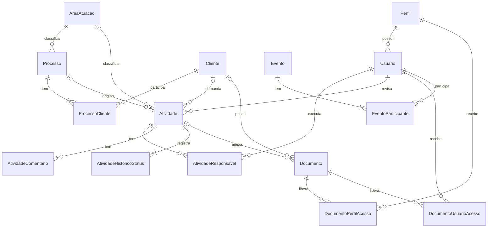
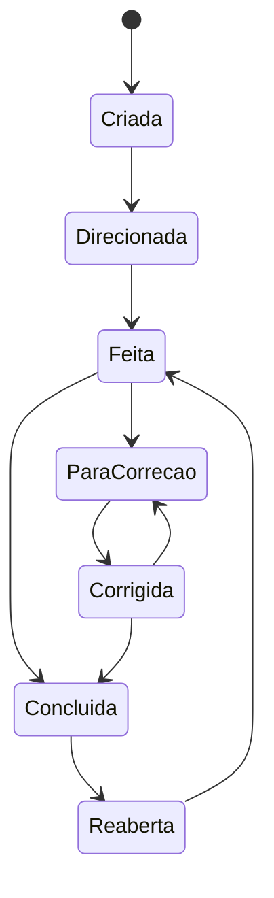

# Sistema de Controle de Atividades Jurídicas — Modelagem de Domínio

Data: 2026-10-06
Estado: aguardando revisão

## 1. Objetivo

Entregar a um escritório de advocacia uma ferramenta para criar, direcionar, executar, revisar e acompanhar atividades jurídicas, com cadastro de clientes, processos, documentos e agenda, e trilha de auditoria completa.

Esta spec define o modelo de domínio e as decisões de arquitetura. Ela não contém código. O uso de IA para produtividade é um objetivo posterior e não faz parte deste documento.

### Critérios de sucesso

- A Diretoria consegue criar uma atividade, direcioná-la a um ou mais responsáveis, revisá-la e concluí-la, com todo o percurso registrado.
- Um usuário de Produção enxerga apenas as atividades em que é responsável e apenas o seu próprio direcionamento.
- Contratos de Honorários nunca ficam acessíveis a usuários de Produção.
- Toda alteração e toda consulta feita no sistema pode ser rastreada pela Diretoria.

## 2. Decisões de arquitetura

| Tema | Decisão |
|---|---|
| Estilo | Monolito, DDD em camadas, escritório único (sem multi-tenant) |
| Plataforma | .NET 10, Blazor com renderização Interactive Server |
| Persistência | EF Core + PostgreSQL |
| Solução | Quatro projetos: `Domain`, `Application`, `Infrastructure`, `Web` |
| Chamada UI → aplicação | As páginas Blazor chamam os casos de uso diretamente; não há API HTTP intermediária |

### Dependências entre projetos

- `Domain`: nenhuma dependência de pacote ou projeto. Agregados, entidades, value objects, enums, exceções de domínio.
- `Application`: depende de `Domain`. Casos de uso (uma pasta por caso), interfaces de repositório e de serviços externos, autorização, `Resultado`.
- `Infrastructure`: depende de `Application` e `Domain`. `DbContext`, configurações de mapeamento (uma classe por entidade), repositórios, unidade de trabalho, armazenamento de arquivos, interceptor de auditoria, migrations.
- `Web`: depende das três. Componentes e páginas Blazor, autenticação, composição de dependências.

Dentro de cada camada há uma pasta por contexto.

### Referência

O repositório `C:\GitHub\NossoCT` serve de referência em duas partes distintas:

- `Administrativo` (Blazor Interactive Server, Domain/Application/Infrastructure/Web): referência de estrutura, entidades ricas, value objects, repositórios, unidade de trabalho e mapeamento por classe de configuração.
- `Comuns` + `NossoCTProject` (ASP.NET MVC, não Blazor): referência conceitual para perfis, desenho da auditoria (interceptor + contexto do ator + tabela com diferenças em JSON) e abstração de armazenamento de arquivos.

Não são copiados: multi-tenant por banco, mensageria, microserviços, controller CRUD genérico com bind de entidade, catálogo de permissões granulares, permissões em claims de cookie, arquivos binários dentro do banco.

## 3. Contextos

| Contexto | Agregados | Depende de |
|---|---|---|
| Identidade | `Usuario`, `Perfil` | — |
| Cadastros | `Cliente`, `Processo`, `AreaAtuacao` | Identidade |
| Documentos | `Documento` | Identidade |
| Atividades | `Atividade` | Identidade, Cadastros, Documentos |
| Agenda | `Evento` | Identidade, Cadastros, Atividades |
| Auditoria | `RegistroAuditoria`, `RegistroAcesso` | Identidade |

Agregados de contextos diferentes se referenciam apenas por Id.

## 4. Regras comuns a todas as entidades

- `Id`: Guid versão 7.
- Carimbos: `CriadoEm`, `CriadoPor`, `AtualizadoEm`, `AtualizadoPor`.
- Exclusão sempre lógica: `ExcluidoEm`, `ExcluidoPor`, com filtro global nas consultas. Nenhum registro de negócio é removido fisicamente.
- Datas e horas gravadas em UTC e exibidas no fuso do escritório, definido em configuração.
- As tabelas de auditoria (seção 10) são exceção: não têm carimbos de atualização nem exclusão lógica.

## 5. Identidade

### Perfil

| Campo | Regra |
|---|---|
| `Nome` | Obrigatório, único |
| `Tipo` | Enum `TipoPerfil`: `Diretoria` ou `Producao` |
| `Ativo` | Perfil inativo não pode ser atribuído a usuário |

Semeado com dois perfis: "Diretor" (`Diretoria`) e "Produção" (`Producao`). Perfis criados depois escolhem um dos dois tipos. As regras de negócio consultam o `Tipo`; a lista de acesso de documentos usa o `PerfilId`.

Regras:

- Somente a Diretoria cria, renomeia, inativa e reativa perfis. Não há exclusão de perfil.
- O `Tipo` não muda depois de criado: trocar o tipo mudaria de uma vez o acesso de todos os usuários do perfil.
- O nome é único sem diferenciar maiúsculas.
- Um perfil com usuário ativo não pode ser inativado; antes, troca-se o perfil desses usuários. Um usuário cujo perfil está inativo não pode ser reativado enquanto o perfil não for reativado ou trocado.
- Inativar um perfil não revoga o que ele já recebeu: ele permanece nas listas de acesso em que estava (seção 7).

### Usuario

| Campo | Regra |
|---|---|
| `Nome` | Obrigatório |
| `Email` | Obrigatório, único; é o login |
| `SenhaHash` | PBKDF2; nunca exposto nem auditado |
| `PerfilId` | Obrigatório; exatamente um perfil por usuário |
| `NumeroOab` | Opcional |
| `Ativo` | Ver regras abaixo |
| `UltimoAcessoEm` | Atualizado no login |
| `VersaoDeSessao` | Identificador da geração de sessões do usuário; ver "Sessões" |
| `FalhasDeLogin`, `BloqueadoAte` | Controle do bloqueio de login; ver "Bloqueio de login" |

Regras:

- Usuário inativo não faz login e não pode ser incluído como responsável, revisor ou participante. Continua visível no histórico.
- O sistema sempre mantém ao menos um usuário ativo com perfil de tipo `Diretoria`. Inativar, excluir ou trocar o perfil do último é recusado.
- Não há cadastro público. Somente a Diretoria cria, edita, inativa usuários e troca perfis.
- Antes de inativar um usuário, a tela mostra à Diretoria o que ficará parado com ele: partes de atividade pendentes, atividades não concluídas em que ele é o revisor e eventos ainda não terminados em que participa. É um aviso, não um bloqueio: a inativação segue com uma segunda confirmação.
- O nome dos usuários ativos é visível a qualquer usuário autenticado, para a escolha de participantes de evento. Os demais dados de usuário são da Diretoria.

### Autenticação e autorização

- Autenticação por cookie.
- Toda página exige usuário autenticado por padrão; o acesso anônimo é exceção declarada (tela de login).
- A autorização tem duas fontes:
  1. o `Tipo` do perfil do usuário;
  2. a relação do usuário com o recurso (é responsável da atividade, está na lista de acesso do documento, participa do evento).
- As regras são verificadas nos casos de uso da `Application`. A interface apenas oculta o que o usuário não pode fazer.
- O perfil e o estado ativo do usuário são lidos do banco a cada operação, não de dados guardados no cookie, para que uma mudança de perfil ou inativação valha imediatamente.

### Sessões

- Cada usuário tem uma `VersaoDeSessao`. O cookie de autenticação carrega a versão vigente no momento do login.
- A versão é renovada quando a senha do usuário é alterada ou redefinida e quando o usuário é inativado.
- Uma sessão cuja versão difere da vigente é recusada na operação seguinte, tanto em requisições novas quanto em telas já abertas. Reativar um usuário não revive sessões antigas.
- Quem altera a própria senha é levado de volta à tela de login.

### Bloqueio de login

- Após 5 tentativas seguidas com senha errada, o login do usuário fica bloqueado por 15 minutos. Durante o bloqueio nenhuma senha é aceita.
- Um login bem-sucedido zera a contagem de falhas.
- A redefinição de senha pela Diretoria remove o bloqueio.
- Tentativas com e-mail inexistente ou de usuário inativo recebem a mesma mensagem de credenciais inválidas e não geram bloqueio.

### Matriz de acesso

| Recurso | Diretoria | Produção |
|---|---|---|
| Usuários e perfis | Tudo | Sem acesso |
| Áreas de atuação | Tudo | Lê os nomes ao consultar cadastros; não gerencia |
| Clientes e processos | Tudo | Somente leitura |
| Documentos Gerais | Tudo | Leitura conforme lista de acesso |
| Contratos de Honorários | Tudo | Sem acesso |
| Atividades | Tudo | Somente as em que é responsável |
| Agenda | Todos os eventos | Eventos em que participa ou que criou; cria os seus |
| Auditoria | Consulta | Sem acesso |

## 6. Cadastros

### AreaAtuacao

`Nome` (obrigatório, único) e `Ativo`. Representa o ramo do direito (Trabalhista, Cível, Tributário etc.). Área inativa não pode ser usada em registros novos.

### Cliente

Classe abstrata com duas derivadas, persistidas em uma tabela com discriminador.

| Classe | Campos |
|---|---|
| `Cliente` (base) | `Email`, `Telefone`, `Endereco` (value object), `Observacoes`, `Ativo` |
| `ClientePessoaFisica` | `NomeCompleto` (obrigatório), `Cpf` (value object, obrigatório, único), `Rg`, `DataNascimento` |
| `ClientePessoaJuridica` | `RazaoSocial` (obrigatório), `NomeFantasia`, `Cnpj` (value object, obrigatório, único), `NomeResponsavel`, `InscricaoEstadual`, `InscricaoMunicipal` |

- `Cpf` e `Cnpj` validam dígitos verificadores. O CNPJ aceita o formato alfanumérico (letras maiúsculas nas doze primeiras posições).
- O nome de exibição fica em um campo só, `Nome`: é o nome completo da pessoa física e a razão social da pessoa jurídica.
- O endereço é um objeto de valor sempre presente, que pode estar vazio.
- A busca por nome não diferencia maiúsculas nem acentos; um texto que seja um CPF ou CNPJ válido procura pelo documento exato.
- O tipo do cliente (PF ou PJ) não muda depois de criado.
- As áreas "Documentos Gerais", "Contratos de Honorários" e "Documentos de Atividades" do cliente são consultas ao contexto Documentos filtradas por cliente e categoria; não são coleções do agregado `Cliente`.

### Processo

| Campo | Regra |
|---|---|
| `NumeroCnj` | Value object; opcional; único quando informado |
| `Titulo` | Obrigatório |
| `AreaAtuacaoId` | Obrigatório |
| `Status` | Enum: `Ativo`, `Suspenso`, `Arquivado`, `Encerrado` |
| `Orgao`, `Comarca`, `ParteContraria` | Opcionais |
| `DataDistribuicao`, `ValorCausa`, `Observacoes` | Opcionais |

`ProcessoCliente` (dentro do agregado): `ClienteId` e `Polo` (enum `Ativo`, `Passivo`, `Terceiro`).

Regras:

- Um processo tem ao menos um cliente; um cliente não se repete no mesmo processo.
- Não é possível remover do processo um cliente que tenha atividade vinculada a esse processo. Conta a atividade viva; atividade excluída não impede.
- Alterar a área do processo altera a área de todas as atividades vinculadas a ele, inclusive as concluídas, na mesma transação, com um registro de alteração por atividade.
- Área ou cliente inativo não entra em vínculo novo, mas permanece no processo que já o tinha.
- `ValorCausa`, quando informado, não é negativo, tem no máximo duas casas decimais e cabe em `numeric(18,2)`.
- Cada vínculo com cliente é um registro com carimbos e exclusão lógica próprios; retirar um cliente exclui logicamente o vínculo, e o mesmo cliente pode voltar ao processo depois. O banco não apaga vínculos em cascata.
- Toda mudança nos vínculos carimba a última alteração do processo e gera o evento `processo_clientes_alterados` (ver seção 10).
- Edições simultâneas do mesmo processo: a segunda gravação é recusada como conflito ("O processo foi alterado por outra pessoa. Recarregue e tente novamente."). O controle cobre gravações concorrentes; um formulário aberto há mais tempo ainda grava por cima do estado atual.
- Abrir um processo mostra o nome e o documento (CPF/CNPJ) de cada cliente; a consulta fica registrada como visualização do processo.

## 7. Documentos

### Documento

| Campo | Regra |
|---|---|
| `Nome` | Obrigatório; padrão é o nome do arquivo enviado; editável |
| `NomeArquivoOriginal`, `TipoConteudo`, `TamanhoBytes` | Preenchidos no envio; imutáveis |
| `HashSha256` | Calculado no envio; imutável |
| `ChaveArmazenamento` | Localização do arquivo no armazenamento; imutável |
| `Categoria` | Enum: `DocumentoGeral`, `ContratoHonorarios`, `DocumentoAtividade`; imutável |
| `ClienteId` | Obrigatório em `DocumentoGeral` e `ContratoHonorarios`. Em `DocumentoAtividade` é sempre o cliente da atividade (nulo se ela for avulsa) |
| `AtividadeId` | Obrigatório em `DocumentoAtividade` |

Tabelas auxiliares, dentro do agregado:

- `DocumentoPerfilAcesso`: `DocumentoId`, `PerfilId`.
- `DocumentoUsuarioAcesso`: `DocumentoId`, `UsuarioId`.

### Armazenamento

O arquivo fica fora do banco de dados, atrás de uma interface de armazenamento definida na `Application`. A primeira implementação grava em disco; a troca por armazenamento de objetos não altera o domínio. O banco guarda somente metadados e hash.

Não há versionamento. Substituir um documento é enviar um novo e excluir logicamente o anterior.

- A chave de armazenamento é gerada pelo servidor; o nome do arquivo enviado é apenas um metadado (só o último segmento do caminho é guardado) e nunca é usado como caminho.
- O envio grava primeiro o arquivo e depois o registro; se o registro não for gravado, o arquivo é removido.
- Limite de 50 MB por arquivo. Arquivo vazio é recusado.
- A exclusão de um documento é lógica e o arquivo permanece no armazenamento.
- O download é sempre entregue como anexo, com tipo de conteúdo neutro: o tipo informado no envio é só um metadado.
- Fora do ambiente de desenvolvimento, a pasta de armazenamento é configuração obrigatória, com caminho absoluto, e precisa existir antes de a aplicação subir; a aplicação não a cria.
- Um documento cujo arquivo não está no armazenamento é uma falha do servidor, registrada pelo evento `documento_arquivo_ausente`; não é respondido como "não encontrado" a quem tem acesso.
- O hash é guardado para conferência futura; nesta versão ele não é verificado no download.

### Regra de acesso

Uma única função de domínio decide se um usuário pode acessar um documento:

1. Usuário com perfil de tipo `Diretoria` acessa sempre.
2. Contrato de Honorários nunca é acessado por quem não é da Diretoria, mesmo que o usuário ou o seu perfil constem na lista de acesso (caso de quem era da Diretoria quando foi incluído e depois mudou de perfil).
3. Documento de atividade: acessa quem é responsável atual da atividade, enquanto ela não estiver excluída. As listas de acesso não contam para essa categoria, e não são editáveis.
4. Nos demais casos (documento geral), acessa se o seu `PerfilId` constar em `DocumentoPerfilAcesso` ou se ele constar em `DocumentoUsuarioAcesso`.

Listagens exibem apenas documentos que o usuário pode acessar, e o total informado conta só esses.

- Baixar um documento sem ter acesso responde como não encontrado (seção 11) e gera o evento de segurança de acesso negado, com o documento.
- Pedir a lista de Contratos de Honorários sem ser da Diretoria responde acesso negado: a existência da área não é segredo, o conteúdo dela é.
- Cada entrada das listas de acesso é um registro com carimbos e exclusão lógica próprios. Perfil ou usuário inativo não entra em lista nova, mas permanece na lista em que já estava, e pode ser retirado dela.
- Em documento geral e contrato de honorários, enviar, renomear, excluir e alterar a lista de acesso são da Diretoria. Um cliente inativo continua recebendo documentos.

### Comportamento por categoria

| Categoria | Lista de acesso inicial | Restrição | Quem envia e gerencia |
|---|---|---|---|
| `DocumentoGeral` | Todos os perfis ativos | Nenhuma | Diretoria |
| `ContratoHonorarios` | Vazia | O domínio só aceita na lista perfil de tipo `Diretoria` e usuário de perfil `Diretoria`, sem exceção | Diretoria |
| `DocumentoAtividade` | Não há lista gravada: o acesso é o dos responsáveis atuais da atividade | A lista não é editável | Quem vê a atividade (Diretoria e responsáveis) envia; a Diretoria renomeia e exclui |

- Um perfil criado depois é incluído automaticamente na lista de acesso de todos os Documentos Gerais existentes, na mesma transação da criação. Essas entradas são gravadas de uma vez, sem um registro de auditoria por entrada: o evento `perfil_incluido_nos_documentos_gerais` guarda o perfil e a quantidade de documentos, e cada entrada leva quem e quando a criou. O Id dessas entradas é gerado pelo banco (exceção à regra do Guid versão 7 da seção 4).
- Reativar um perfil não o inclui nos Documentos Gerais enviados enquanto ele esteve inativo.
- Um documento enviado no mesmo instante em que um perfil é criado pode nascer sem o perfil novo; a Diretoria o inclui pelo editor de acesso.
- Um usuário incluído como responsável de uma atividade recebe acesso aos documentos já anexados a ela. Removê-lo da atividade retira esse acesso. Como o acesso é calculado a cada consulta, isso vale na operação seguinte, sem cópia a manter.

### Documentos de atividade

- Anexa arquivos a uma atividade quem a vê: a Diretoria (onde estão o revisor e o autor) e os responsáveis. A regra efetiva para Produção é ser responsável.
- Todo documento de atividade fica vinculado também ao cliente da atividade: o `ClienteId` do documento é preenchido com o da atividade no envio. Em atividade avulsa ele fica nulo.
- Se o cliente da atividade for alterado, o `ClienteId` dos documentos dela acompanha a alteração. Toda edição da atividade realinha os documentos que estiverem com outro cliente.
- Excluir uma atividade não exclui os seus documentos: eles continuam na ficha do cliente para a Diretoria e deixam de aparecer para a Produção.
- Na ficha do cliente esses documentos aparecem em uma terceira área, "Documentos de Atividades", ao lado de "Documentos Gerais" e "Contratos de Honorários", com a indicação da atividade de origem.
- O vínculo com o cliente não amplia o acesso: a área lista apenas os documentos que o usuário pode acessar pela regra acima. Um usuário de Produção vê ali somente os documentos das atividades em que é responsável.

## 8. Atividades

### Atividade (raiz do agregado)

| Campo | Regra |
|---|---|
| `Titulo` | Obrigatório |
| `Descricao` | Obrigatório |
| `DataEntrega` | Obrigatória a partir do status `Direcionada` |
| `Status` | Enum `StatusAtividade` (ver fluxo) |
| `ConcluidaEm` | Preenchido ao entrar em `Concluida`; limpo ao reabrir |
| `ClienteId` | Opcional |
| `ProcessoId` | Opcional |
| `AreaAtuacaoId` | Com processo: igual à do processo, não editável. Sem processo: opcional, informada |
| `TipoAutor` | Enum: `Usuario` ou `Sistema` |
| `AutorId` | Usuário de Diretoria quando `TipoAutor = Usuario`; nulo quando `Sistema` |
| `RevisorId` | Usuário de Diretoria; obrigatório a partir de `Direcionada` |

Regras de vínculo:

- Com processo, o cliente é obrigatório e deve ser um dos clientes do processo.
- Atividade avulsa é a que não tem cliente nem processo.
- Uma atividade pode ter cliente sem processo.

### Entidades internas

| Entidade | Campos | Regra |
|---|---|---|
| `AtividadeResponsavel` | `UsuarioId`, `Direcionamento`, `ConcluidoEm` | Um usuário não se repete na mesma atividade. `ConcluidoEm` nulo significa parte pendente |
| `AtividadeComentario` | `Texto`, `UsuarioId`, `DataHora` | Imutável depois de criado. É gravado à parte da atividade: comentar não altera a atividade nem a versão dela. Vale em qualquer status. Com a atividade excluída, os comentários ficam inacessíveis |
| `AtividadeHistoricoStatus` | `Ordem`, `StatusAnterior`, `StatusNovo`, `UsuarioId`, `DataHora`, `Motivo` | Somente inserção. `Ordem` numera as transições dentro da atividade. `UsuarioId` nulo indica transição feita pelo sistema |

### Fluxo de status

| De | Para | Gatilho | Quem |
|---|---|---|---|
| — | `Criada` | Criação sem responsável | Diretoria ou sistema |
| `Criada` | `Direcionada` | Definição de ao menos um responsável, do revisor e da data de entrega | Diretoria |
| `Direcionada` | `Feita` | Último responsável conclui sua parte | Automático |
| `Feita`, `Corrigida` | `Concluida` | Aprovação | Revisor |
| `Feita`, `Corrigida` | `ParaCorrecao` | Devolução com motivo e responsáveis selecionados | Revisor |
| `ParaCorrecao` | `Corrigida` | Último responsável selecionado conclui novamente | Automático |
| `Concluida` | `Reaberta` | Reabertura com motivo e responsáveis selecionados | Diretoria |
| `Reaberta` | `Feita` | Último responsável selecionado conclui | Automático |

Regras do fluxo:

- Qualquer transição fora da tabela é recusada pelo domínio.
- Toda transição insere uma linha em `AtividadeHistoricoStatus`. Criar a atividade já com responsáveis insere duas: `Criada` e `Direcionada`.
- Na devolução e na reabertura o motivo é obrigatório e é gravado no histórico. A seleção de responsáveis vem com todos marcados por padrão e exige ao menos um; os selecionados têm `ConcluidoEm` limpo, os demais permanecem concluídos.
- Um responsável só conclui sua parte nos status `Direcionada`, `ParaCorrecao` e `Reaberta`, e só se a parte estiver pendente.
- "Atrasada" não é status. É uma condição calculada: `DataEntrega` anterior à data atual e status diferente de `Concluida`.
- Não existe status de cancelamento. Atividade criada por engano é excluída logicamente pela Diretoria.
- Uma transição marcada como "Automático" na tabela é registrada no histórico com o usuário cuja ação a provocou (quem concluiu a última parte). `UsuarioId` nulo fica reservado a transições feitas pelo próprio sistema.
- Depois de direcionada, a atividade não fica sem responsável: a lista não pode ser esvaziada.
- Se a Diretoria remove o último responsável pendente e todos os que ficaram já concluíram, a atividade avança como se o último tivesse concluído (`Feita` ou `Corrigida`), e a linha do histórico leva o motivo "Responsável pendente removido."
- Usuário inativo não entra como responsável, mas quem já era responsável permanece até ser retirado.
- Edições simultâneas: uma gravação feita sobre uma versão que já mudou é recusada como conflito ("A atividade foi alterada por outra pessoa. Recarregue e tente novamente."). Editar, definir responsáveis, trocar o revisor e excluir enviam a versão que o usuário estava vendo.

### Regra do revisor

- Quando há exatamente um responsável ativo com perfil de tipo `Diretoria`, `RevisorId` é esse usuário e o domínio recusa alterá-lo. Um responsável de Diretoria que foi inativado ou mudou para um perfil de Produção não conta.
- Quando não há nenhum, ou há dois ou mais, a Diretoria escolhe o revisor entre os usuários ativos de tipo `Diretoria`.
- A regra é reavaliada a cada inclusão ou remoção de responsável. Se a reavaliação liberar a escolha, o revisor atual é mantido até que a Diretoria o altere.
- Quando o revisor é o único responsável da atividade, concluir a parte leva a atividade diretamente a `Concluida`. O histórico registra as duas transições (`Feita` e `Concluida`). O mesmo vale quando é o próprio revisor quem remove o último pendente e fica como único responsável; se outro diretor faz a remoção, a atividade para em `Feita`/`Corrigida` e o revisor aprova.
- Só aprova e devolve o revisor que continua sendo um usuário ativo de Diretoria; o atalho acima também exige isso. Se o revisor deixou de ser, a Diretoria troca o revisor.

### Permissões

| Ação | Quem |
|---|---|
| Criar, editar, excluir | Diretoria |
| Incluir e remover responsáveis, editar direcionamentos | Diretoria, nos status `Criada`, `Direcionada`, `ParaCorrecao` e `Reaberta` |
| Trocar revisor | Diretoria, em qualquer status exceto `Concluida` (inclui `Feita` e `Corrigida`, para a atividade não ficar presa quando o revisor deixa o escritório) |
| Aprovar e devolver | O revisor da atividade |
| Reabrir | Diretoria |
| Concluir a própria parte | O responsável |
| Comentar | Diretoria e responsáveis |
| Ver a atividade | Diretoria e responsáveis |
| Ver um direcionamento | Diretoria e o responsável a quem ele se destina |

Um responsável de Produção vê os nomes dos demais responsáveis, mas não os direcionamentos deles. Quem vê a atividade vê também o histórico, com os motivos de devolução e de reabertura.

- Quem não pode ver uma atividade recebe a mesma resposta de uma atividade inexistente (seção 11), e a tentativa gera o evento de acesso negado, com a atividade.
- A listagem de quem não é da Diretoria traz só as atividades em que ele é responsável, qualquer que seja o filtro pedido. A Diretoria filtra também por responsável e por revisor, inclusive inativos.
- "Atrasada" usa a data do escritório (fuso configurado), não a data UTC.

## 9. Agenda

### Evento

| Campo | Regra |
|---|---|
| `Titulo` | Obrigatório |
| `Descricao`, `Local` | Opcionais |
| `Tipo` | Enum: `Audiencia`, `Reuniao`, `Prazo`, `Outro` |
| `InicioEm` | Obrigatório, entre os anos 2000 e 2100 |
| `DuracaoEstimadaMinutos` | Obrigatório, de 1 minuto a 7 dias |
| `ClienteId`, `ProcessoId`, `AtividadeId` | Opcionais e independentes |

`EventoParticipante` (dentro do agregado): `UsuarioId`.

Regras:

- Um evento tem ao menos um participante; um usuário não se repete no mesmo evento.
- Com cliente e processo informados, o cliente deve ser um dos clientes do processo.
- Qualquer usuário cria eventos e é incluído como participante na criação. Depois, pode ser retirado da lista como qualquer outro.
- Qualquer usuário inclui outros usuários ativos como participantes. Usuário inativo não entra em evento novo, mas permanece no evento em que já estava.
- Produção vê os eventos em que participa e os que criou. Diretoria vê todos. Para quem não pode ver, o evento responde como inexistente, e a tentativa fica registrada.
- Editam e excluem o evento quem o criou e a Diretoria. Edição e exclusão enviam a versão vista na tela; se o evento mudou nesse intervalo, a operação é recusada com aviso.
- O vínculo (cliente, processo, atividade) só é validado quando muda. Um evento cujo cliente saiu do processo ou foi inativado continua editável com o vínculo que tinha.
- Uma atividade só é vinculada a um evento por quem pode vê-la. Na ficha do evento, o título da atividade aparece só para quem pode vê-la.
- Sobreposição de horário entre eventos de um mesmo participante gera aviso e não impede a gravação. O aviso traz, por participante, o trecho ocupado dentro do intervalo do evento salvo, sem o título nem os demais participantes do outro evento.
- A listagem é por período de até 92 dias. A tela mostra uma semana por vez, de segunda a domingo, no fuso do escritório. A Diretoria filtra por participante, inclusive inativos.

## 10. Auditoria

A trilha é completa: alterações, eventos de segurança e consultas. São duas tabelas, porque o volume e o uso de cada uma são diferentes.

### RegistroAuditoria

Registra criação, alteração e exclusão de dados e eventos de segurança.

| Campo | Conteúdo |
|---|---|
| `DataHora` | Momento da operação |
| `UsuarioId` | Nulo quando a origem é o sistema |
| `Operacao` | Enum: `Criacao`, `Alteracao`, `Exclusao`, `Evento` |
| `Entidade`, `EntidadeId` | Tipo e identificador do registro afetado |
| `Evento` | Nome do evento de segurança, quando `Operacao = Evento` |
| `Dados` | JSON: estado inicial na criação; diferença campo a campo (`de`, `para`) na alteração |
| `Ip`, `IdCorrelacao` | Origem e identificador da requisição |

- Gravado por um interceptor do EF Core, na mesma transação da alteração. Se a gravação do registro falhar, a operação inteira falha.
- Eventos de segurança: login, falha de login, bloqueio de login, logout, troca e redefinição de senha, mudança de perfil, ativação e inativação de usuário, mudança na lista de acesso de documento, tentativa de acesso negada.
- A mudança na lista de acesso de um documento gera o evento `documento_acesso_alterado` no documento, com os perfis e usuários incluídos e retirados, na mesma transação. A criação e a exclusão de um documento aparecem pelos registros do próprio documento e de cada entrada da lista, sem evento.
- `atividade_responsaveis_alterados` é anotado na atividade quando os seus responsáveis ou direcionamentos mudam, com os usuários incluídos, removidos e com direcionamento alterado, na mesma transação.
- `perfil_incluido_nos_documentos_gerais` registra, no perfil recém-criado, em quantos Documentos Gerais ele foi incluído. Criar, renomear, inativar e reativar um perfil aparecem pelos registros de alteração do próprio perfil, sem evento.
- `documento_arquivo_ausente` registra a tentativa de baixar um documento cujo arquivo não está no armazenamento.
- A tentativa de acesso negada, quando vem de uma consulta, leva o recurso ou os filtros pedidos.
- `evento_participantes_alterados` é anotado no evento da agenda quando os seus participantes mudam numa edição, com os usuários incluídos e removidos, na mesma transação.
- Eventos de negócio usam a mesma operação `Evento`: `processo_clientes_alterados`, anotado no processo quando seus clientes ou polos mudam, com os vínculos incluídos, removidos e alterados em `Dados`. Os clientes informados na criação do processo aparecem nos registros de criação dos vínculos, não nesse evento.
- Gravações que não são alteração de negócio (último acesso, contagem de falhas e bloqueio de login) não geram registro de alteração; os eventos de segurança correspondentes cobrem esses fatos.
- `SenhaHash` e `VersaoDeSessao` nunca aparecem em `Dados`.
- Em hierarquias, o registro leva o nome do tipo raiz (`Cliente` para pessoa física e jurídica). Os campos de objetos de valor entram com o nome composto (`Endereco.Cidade`).
- Os dados pessoais dos cadastros (documento, endereço, contato, observações) fazem parte do registro de cada alteração, e o texto digitado nas buscas faz parte do registro de consultas. Como as duas tabelas são somente-inserção, um dado corrigido ou excluído no cadastro permanece na trilha.

### RegistroAcesso

Registra consultas.

| Campo | Conteúdo |
|---|---|
| `DataHora`, `UsuarioId`, `Ip` | Quem e quando |
| `TipoRecurso`, `RecursoId` | O que foi consultado; `RecursoId` nulo em listagens |
| `Acao` | Enum: `Listou`, `Visualizou`, `Baixou` |
| `Detalhe` | Filtros usados na listagem |

- Gravado na `Application`, em cada caso de uso de consulta concluído com sucesso. Se o registro do acesso falhar, a consulta falha.
- A consulta interna que a interface faz para saber quem é o usuário atual não gera registro.
- Em documentos: listar os documentos de um cliente ou de uma atividade registra `Listou`; baixar registra `Baixou`; ver a lista de acesso de um documento registra `Visualizou`.
- Em atividades: listar registra `Listou`; abrir uma atividade registra `Visualizou`; listar os comentários de uma atividade registra `Listou` (recurso `AtividadeComentario`).
- Na agenda: listar eventos registra `Listou`; abrir um evento registra `Visualizou`.

### Regras comuns

- As duas tabelas são somente-inserção: não há edição, exclusão nem exclusão lógica.
- A consulta é exclusiva da Diretoria, com filtros por período, usuário, entidade ou recurso e operação. A consulta de alterações filtra também por registro (tudo o que aconteceu com um identificador) e por gravação (tudo o que foi gravado junto, pelo identificador de correlação).
- Consultar a auditoria gera um `RegistroAcesso`.
- Os registros são mantidos por tempo indeterminado. As duas tabelas têm índice por data; `RegistroAuditoria` tem também índice por registro e por correlação. O particionamento de `RegistroAcesso` por mês fica adiado até que o volume o justifique; a conversão é uma migration, sem impacto no domínio.
- `AtividadeHistoricoStatus` não é substituído pela auditoria: ele é dado de negócio, exibido na tela da atividade.

## 11. Tratamento de erros

- Violação de invariante lança exceção de domínio.
- Os casos de uso devolvem um `Resultado` com tipo de erro: `Validacao`, `NaoEncontrado`, `AcessoNegado`, `Conflito`.
- A interface traduz o tipo de erro em mensagem ao usuário. Erros não previstos são registrados em log técnico e exibidos como mensagem genérica.
- Um recurso que o usuário não pode ver responde como `NaoEncontrado`, para não revelar a existência dele. Exceção declarada: a lista de Contratos de Honorários responde `AcessoNegado` a quem não é da Diretoria (seção 7).

## 12. Testes

- Unitários no `Domain`, sem banco: fluxo de status da atividade (todas as transições válidas e as recusadas), regra do revisor, conclusão por responsável, regra de acesso a documentos e restrição do Contrato de Honorários, invariantes de vínculo entre atividade, cliente e processo.
- De integração na `Infrastructure` e `Application`, com PostgreSQL real em contêiner: mapeamentos, filtro de exclusão lógica, interceptor de auditoria, autorização dos casos de uso.

## 13. Fora do escopo

Recursos de IA; notificações por e-mail ou mensagem; recorrência de eventos e de atividades; controle de horas e financeiro; portal do cliente; permissões granulares por ação; versionamento de documentos; múltiplos escritórios.
